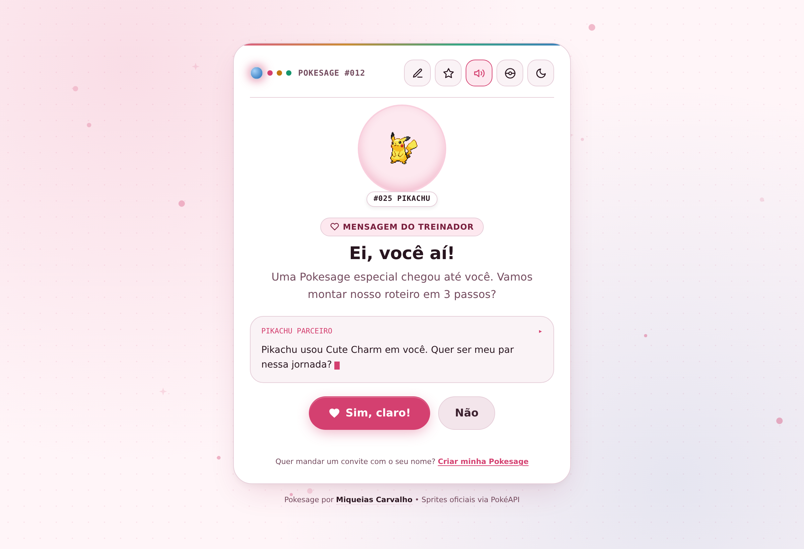
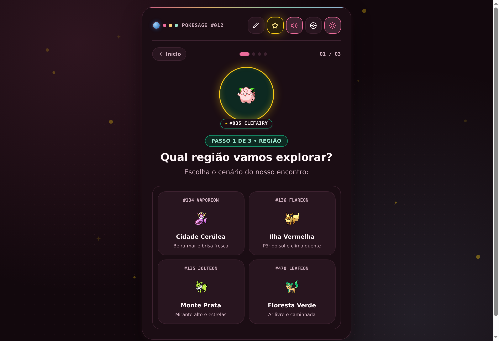
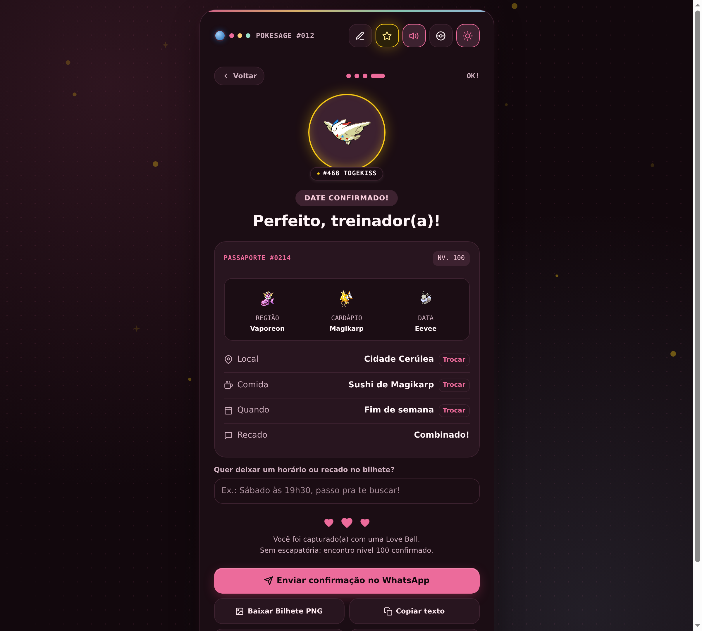
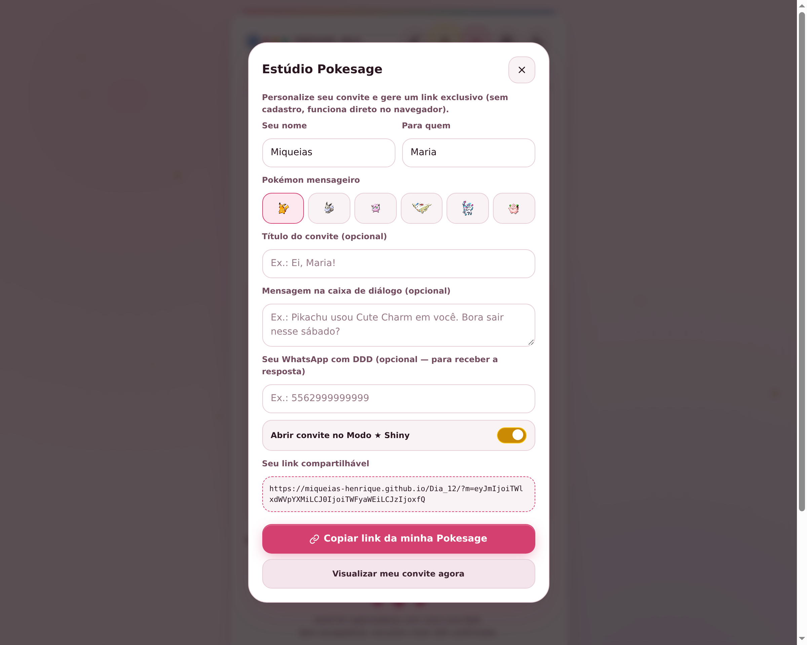
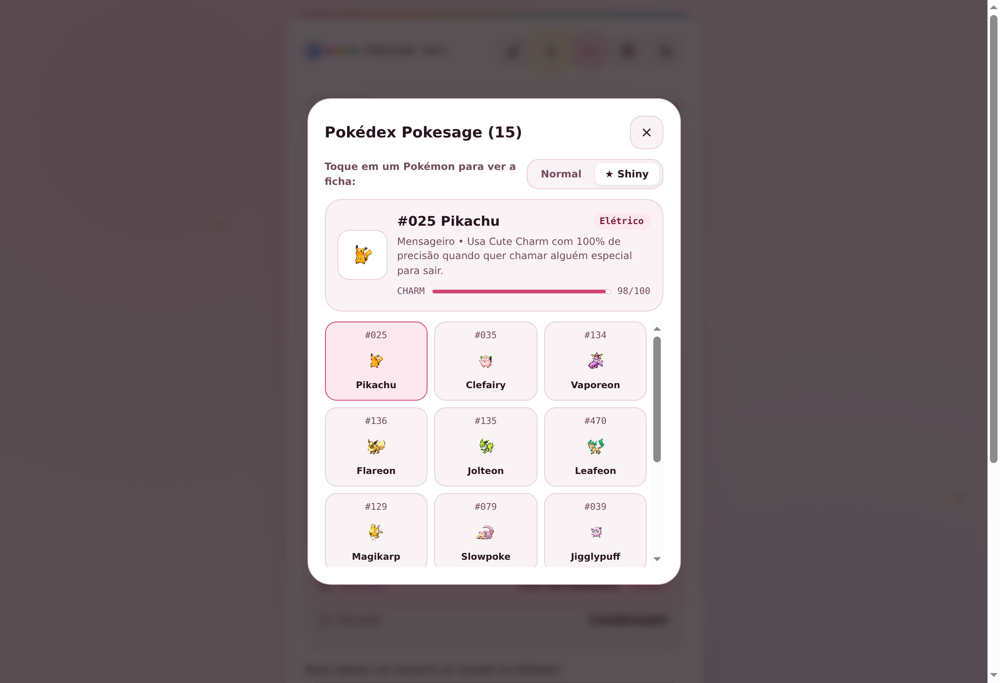

<div align="center">

# Pokesage `#012`

**Estação interativa de convites Pokémon (`Pokémon + Mensage`) — zero-backend, com gerador de links personalizados, bilhete colecionável PNG, modo ★ Shiny, sintetizador 8-bit em Web Audio API e Design System W3C DTCG.**

[](https://miqueias-henrique.github.io/Dia_12/)
[](https://tailwindcss.com/)
[](./tokens.json)
[](./assets/js/pokesage.js)
[](./assets/js/pokesage.js)

**[Acessar o site ao vivo → https://miqueias-henrique.github.io/Dia_12/](https://miqueias-henrique.github.io/Dia_12/)**

</div>

---

## Galeria do Projeto

<table>
  <tr>
    <td align="center" width="50%">
      
      <br /><sub><strong>Tela inicial (Light Mode)</strong> — Caixa de diálogo RPG com efeito typewriter e partículas ambiente</sub>
    </td>
    <td align="center" width="50%">
      
      <br /><sub><strong>Dark Mode + ★ Modo Shiny</strong> — Sprites Shiny oficiais locais e paleta dinâmica por etapa</sub>
    </td>
  </tr>
  <tr>
    <td align="center" width="50%">
      
      <br /><sub><strong>Passaporte Holofoil</strong> — Equipe escolhida, recado ao vivo, exportação PNG e WhatsApp</sub>
    </td>
    <td align="center" width="50%">
      
      <br /><sub><strong>Estúdio Pokesage</strong> — Crie seu próprio convite com link Base64URL compartilhável (zero-backend)</sub>
    </td>
  </tr>
</table>

<details>
  <summary><strong>Ver também: Pokédex Interativa (15 Pokémon com Inspector e aba Normal / ★ Shiny)</strong></summary>
  <br />
  <p align="center">
    
  </p>
</details>

---

## Principais Funcionalidades

- **Estúdio Pokesage (Zero-Backend URL Encoder):** qualquer visitante pode personalizar remetente, destinatário, Pokémon mensageiro, título, mensagem, WhatsApp de resposta e modo Shiny, gerando um link único codificado em **Base64URL UTF-8** (`?m=...`) que funciona 100% no navegador sem banco de dados.
- **Exportação de Bilhete Colecionável em PNG (`1080×1350`):** renderizador dedicado em **Canvas 2D** com `imageSmoothingEnabled = false` para pixel-art nítida, adaptando automaticamente as cores do tema ativo (Light ou Dark) diretamente dos Design Tokens CSS.
- **Modo ★ Shiny & 30 Sprites Locais (Zero CLS):** todos os 15 Pokémon em versão Normal e Shiny cacheados localmente em [`assets/sprites/`](./assets/sprites/) (~22 KB no total), garantindo carregamento instantâneo e zero layout shift.
- **Sequência de Captura com Love Ball:** ao concluir o roteiro, uma Love Ball vetorial executa a animação clássica de captura com 3 oscilações, disparo de confete em Canvas e fanfarra sintetizada antes de revelar o Passaporte Holofoil.
- **Sintetizador 8-Bit Procedural (Web Audio API):** sons originais gerados em tempo real (sem arquivos MP3 externos) para navegação, botão "Não" evasivo, brilho Shiny, *cries* únicos para cada um dos 15 Pokémon e fanfarra de captura.
- **Pokédex Interativa:** modal acessível (`role="dialog"`, suporte a `Esc`) com abas Normal / ★ Shiny, barra de atributo `CHARM` e ficha individual de cada Pokémon.
- **Integração Prática:** envio formatado para o **WhatsApp**, cópia com notificação Toast acessível e download de evento `.ics` pronto para Google Calendar / Apple Calendar.

---

## Arquitetura & Engenharia

### 1. Design Tokens em 3 Camadas (W3C DTCG)

Toda a identidade visual nasce em [`tokens.json`](./tokens.json) seguindo o padrão W3C DTCG (`primitive → semantic → component` + `dark.semantic`), garantindo **0 valores hardcoded** em [`src/app.css`](./src/app.css):

```text
tokens.json (W3C DTCG — fonte única da verdade)
   ├── src/tokens.css   (:root + .dark CSS Custom Properties)
   └── src/theme.css    (Tailwind CSS v4 @theme)
           │
           ▼
      src/app.css ──► validate-tokens.cjs (0 violações) ──► dist/styles.css
```

### 2. Estrutura de Diretórios

```text
Dia_12/
├── index.html                  # Marcação semântica acessível (WCAG AA)
├── tokens.json                 # Design Tokens W3C DTCG (3 camadas + Dark Mode)
├── src/
│   ├── tokens.css              # Variáveis CSS compiladas (:root + .dark)
│   ├── theme.css               # Bloco @theme para Tailwind CSS v4
│   └── app.css                 # Folha de estilos 100% orientada a tokens
├── dist/
│   └── styles.css              # CSS final compilado e minificado (Tailwind v4)
├── assets/
│   ├── js/pokesage.js          # Motor modular (AudioEngine, AmbientEngine, UrlCodec, TicketRenderer)
│   └── sprites/                # 15 sprites oficiais + 15 sprites Shiny (PokéAPI)
├── design-system/              # Documentação persistida do Design System (MASTER.md)
├── docs/                       # Capturas de tela em alta resolução
└── .nojekyll                   # Entrega estática direta no GitHub Pages
```

### 3. Acessibilidade e Qualidade
- Contraste WCAG AA em Light Mode e Dark Mode (sem violeta/lavanda, superfícies semânticas pareadas).
- Respeito integral a `@media (prefers-reduced-motion: reduce)` no CSS, no Canvas de partículas e na sequência de captura.
- Alvos de toque com altura mínima de `44px`, navegação por teclado (`:focus-visible`, `Enter`/`Space`, `Esc`) e zero overflow horizontal até `320px`.

---

## Como Executar Localmente

```bash
# 1. Instalar dependências de build (Tailwind CSS v4)
npm install

# 2. Compilar tokens, validar conformidade e gerar o CSS minificado
npm run build

# 3. Servir os arquivos estáticos localmente
npx serve .
```

| Script | Descrição |
|---|---|
| `npm run tokens:css` | Compila `tokens.json` para `src/tokens.css` |
| `npm run tokens:theme` | Compila `tokens.json` para `@theme` do Tailwind v4 (`src/theme.css`) |
| `npm run tokens:validate` | Audita `src/` garantindo 0 cores/tamanhos hardcoded |
| `npm run css:build` | Gera `dist/styles.css` minificado com `@tailwindcss/cli` |
| `npm run build` | Executa todo o pipeline acima em sequência |

---

## Autor & Portfólio

Desenvolvido por **[Miqueias Carvalho](https://github.com/Miqueias-Henrique)** — Desenvolvedor de Software (Backend C#/.NET & SQL Server, APIs REST e Experiências Web Interativas).

Outros projetos interativos em destaque no portfólio:
- **[Galvan-M](https://miqueias-henrique.github.io/Galvan-M/)** — Portfólio interativo inspirado em Galvan Prime e Galvan B
- **[MIKOSHI // Engrama](https://miqueias-henrique.github.io/mikoshi-engrama/)** — Dossiê Neural Interativo
- **[ONO-SENDAI // Deck Tyrell-84](https://github.com/Miqueias-Henrique/ono-sendai-deck)** — Estação retrofuturista em React + Vite
- **[Vosso Cinema API](https://github.com/Miqueias-Henrique/vosso-cinema-api)** — API REST com NestJS, Prisma, PostgreSQL e Swagger

<br />
<sub>Sprites oficiais via <a href="https://github.com/PokeAPI/sprites">PokéAPI/sprites</a>. Projeto sem fins comerciais, criado para fins criativos e de portfólio.</sub>
